# Guide du back-office — Madame Aiguille

Pour Céline. Ce guide suit les gestes du quotidien : ajouter une création, suivre son stock, traiter une commande en
point relais ou en retrait, changer le bandeau, les blocs et les réseaux. Les captures montrent l'administration telle
que vous la voyez avec votre rôle « Atelier ».

Ce que vous ne voyez pas (paiements, transporteurs, comptes administrateurs, réglages techniques) se règle avec Pierre.
Le détail de chaque réglage est dans la documentation technique, §24 « Mémo Céline ».

## 1. Se connecter

1. Ouvrez l'adresse privée de l'administration transmise par Pierre (gardez-la dans votre gestionnaire de mots de
   passe ; elle n'est écrite nulle part ailleurs).
2. Hors de l'atelier (smartphone, déplacement), le navigateur demande d'abord un **identifiant et un mot de passe
   communs**, transmis par Pierre. Depuis une adresse enregistrée, cette étape n'apparaît pas.
3. Saisissez votre identifiant et votre mot de passe Magento.
4. Saisissez le **code à six chiffres** de Google Authenticator. À la toute première connexion, Magento vous envoie un
   email pour associer l'application à votre compte. Téléphone perdu ou changé : Pierre réinitialise la double
   authentification.

Le **tableau de bord** résume les ventes et les dernières commandes. Le menu de gauche ne montre que vos rubriques.

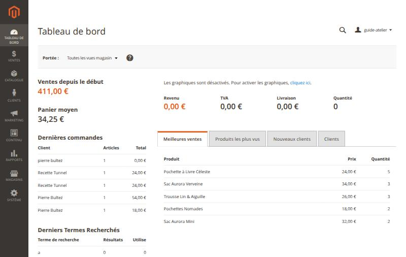

## 2. Ajouter une création

*Catalogue › Produits*, puis **Ajouter un produit** (produit simple). En haut du formulaire, choisissez le **Jeu d'attributs « Création »** : la fiche se recharge avec les bons champs. La flèche à droite du bouton sert à choisir un autre type, par exemple un modèle en deux tailles (configurable).

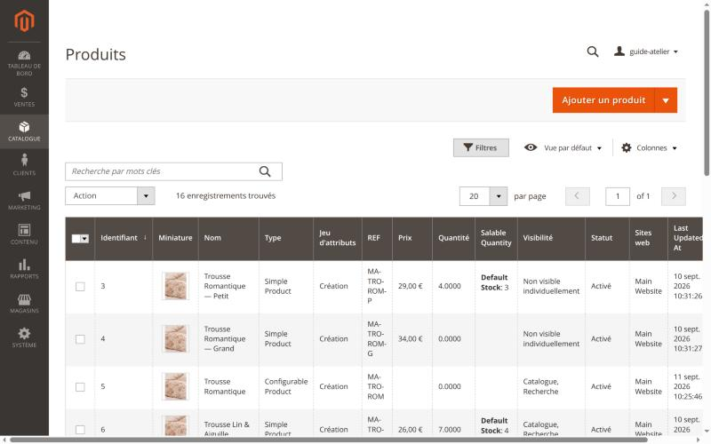

Remplissez, de haut en bas :

| Champ | Ce qu'il faut savoir |
|---|---|
| Activer le produit | Laissez « Non » tant que la fiche n'est pas complète : la création n'est pas visible en boutique |
| Jeu d'attributs | Toujours **Création** |
| Nom de produit | Le nom affiché en boutique |
| REF | Une référence unique, par exemple `MA-TRO-LIN` |
| Prix | Prix payé par la cliente (pas de TVA : franchise en base) |
| Quantité | Le **nombre de pièces** de la série |
| Poids | **Obligatoire**, en kilogrammes (`0.16` pour 160 g). Le poids de l'emballage (0,2 kg) est ajouté automatiquement pour calculer le port |
| Catégories | Une ou plusieurs rubriques de la boutique |
| Visibilité | « Catalogue, Recherche » pour une création vendue seule |
| Définir comme Nouveau | Dates de début et de fin du badge « Nouveauté » et de la section Nouveautés de l'accueil |

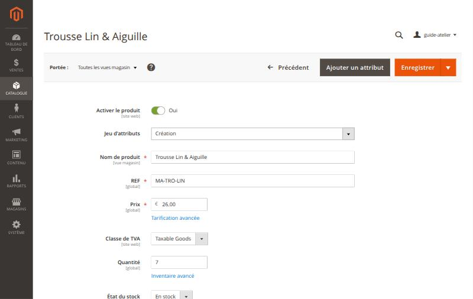

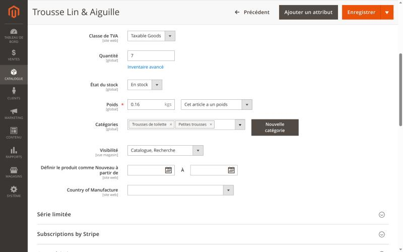

Plus bas :

- **Série limitée** : cochez-la et indiquez le nombre de pièces ; la fiche affiche « Série limitée — N pièces ».
- **Images et vidéos** : photos au format **portrait 4:5**, trois vues au moins, enregistrées **en JPEG ou en WebP** (un PNG
  pèse dix fois plus et ralentit la page ; un WebP est converti en JPEG à l'envoi, sans rien à faire de votre côté). Une photo d'un autre format est rognée, jamais déformée. La première est
  la vignette.
- **Contenu** : la description courte et la description. Le bouton **« Rédiger avec l'IA »** les propose pour vous,
  avec le référencement : voir le §8. Les champs « Composition », « Dimensions » et « Conseils d’entretien »
  remplissent les onglets de la fiche.
- La section **Subscriptions by Stripe** est à ignorer : la boutique ne vend pas d'abonnement.

Un **modèle en deux tailles** est un produit *configurable* sur l'attribut Taille : chaque taille a son stock et son
poids. Demandez à Pierre la première fois.

Cliquez sur **Enregistrer**, vérifiez la fiche en boutique, puis passez *Activer le produit* à « Oui ».

## 3. Suivre le stock

- Le stock baisse tout seul à chaque commande. À 0, la création affiche « Épuisé » et reste visible en fin de liste.
- Une annulation remet les pièces en stock.
- **Rapports › Stock bas** liste les créations **sous 2 pièces** : la dernière pièce d'une série y apparaît. Aucun
  email n'est envoyé, il faut consulter ce rapport. Le seuil se règle par création (*Quantité de notification*).

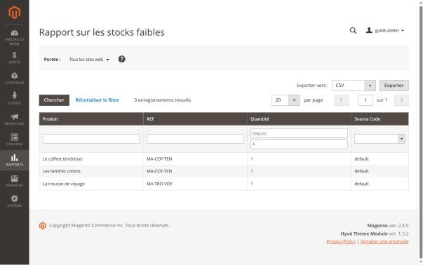

## 4. Traiter une commande

*Ventes › Commandes*, puis **Voir** sur la ligne. Le bouton **Colonnes** permet de masquer les colonnes inutiles de la
liste.

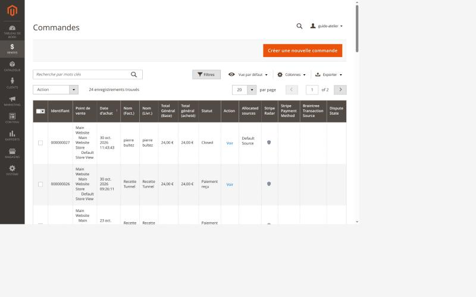

En haut de la commande : **Facturer**, **Expédier**, **Avoir** (remboursement), **Annuler**, **Envoyer un email**.

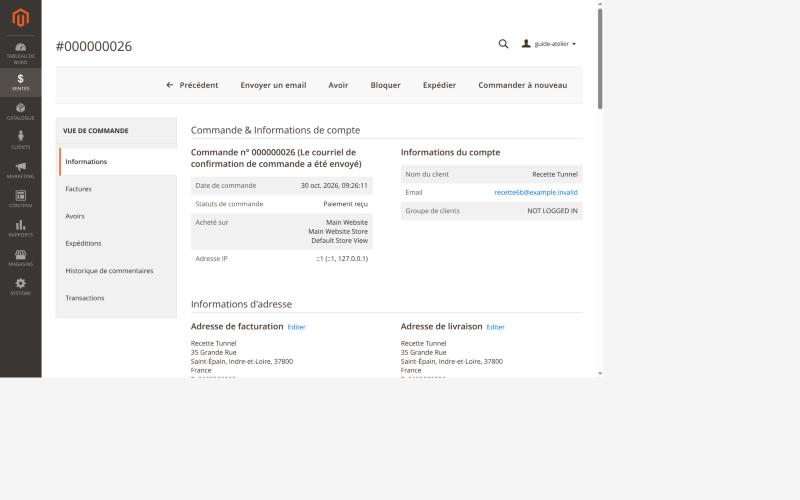

### Changer le statut et prévenir la cliente

En bas de la commande, dans **Notes pour cette commande** : choisissez le **Statut**, écrivez un commentaire si besoin,
cochez **Avertir le client par email** et **Visible dans le magasin** pour qu'elle le lise, puis **Mettre à jour**.

Les six statuts : *En attente de paiement*, *Paiement reçu*, *En préparation*, *Expédiée*, *Prête pour retrait*,
*Livrée*. « Paiement reçu » et « Prête pour retrait » envoient chacun leur email automatiquement.

### Commande en point relais

Elle est payée en ligne à la commande (« Paiement reçu »).

1. L'adresse de livraison est celle du point relais (« NOM — Point relais FR-… »).
2. Créez l'étiquette dans votre **espace pro Mondial Relay** avec cette adresse.
3. Dans la commande, **Expédier**, puis **Ajouter un numéro de suivi** (Mondial Relay et le numéro de l'étiquette).
4. En bas, cochez **Envoyer une copie de la livraison par mail** — sans cette case, la cliente ne reçoit pas l'email
   d'expédition —, puis **Valider l'expédition**. La commande passe « Expédiée ».

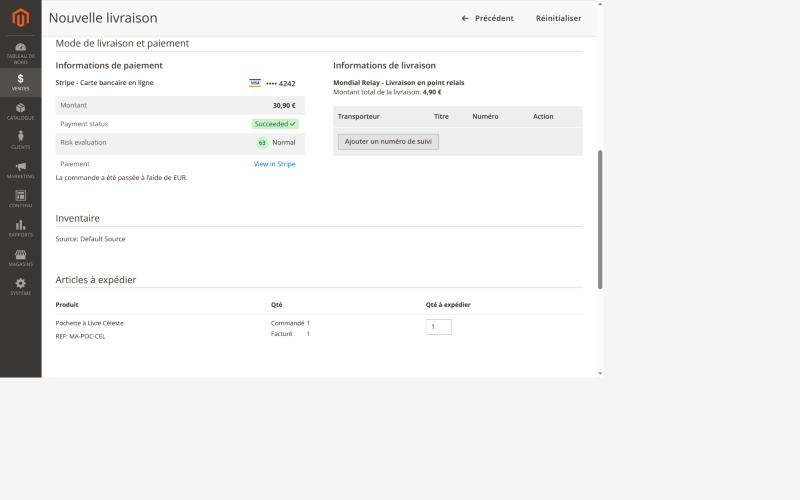

### Commande en retrait à l'atelier

Le rendez-vous est dans **Mode de livraison et paiement › Informations de livraison** (« Retrait à l'atelier … — jeudi
12 novembre 2026 à 10 h 00 »). Les **Informations de paiement** disent si elle est déjà payée.

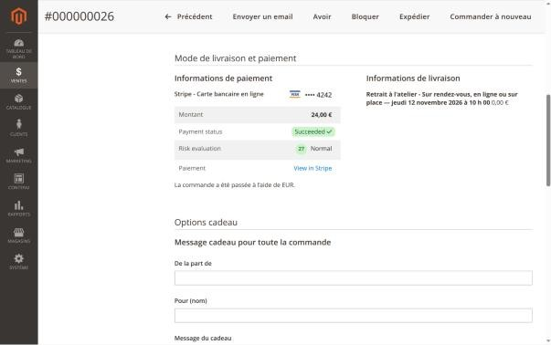

1. **Quand la commande est prête** : statut **Prête pour retrait**, puis **Mettre à jour**. L'email part avec le
   rendez-vous, le lieu, l'itinéraire, et « déjà réglée en ligne » ou « règlement sur place ».

   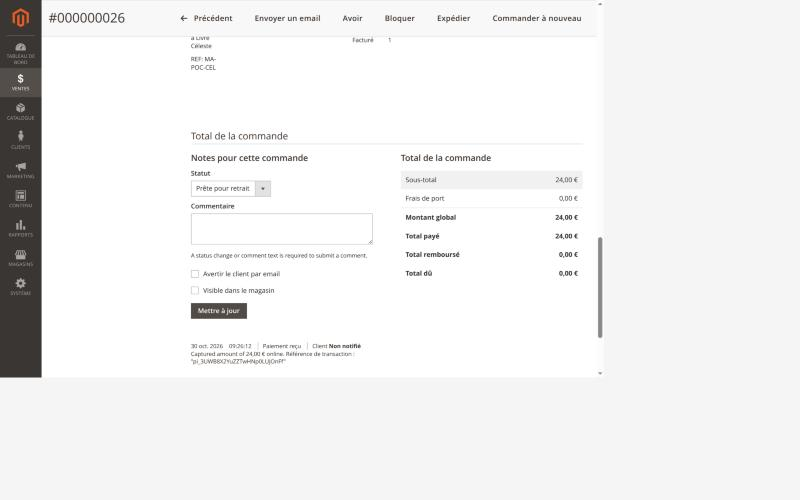

2. **Au rendez-vous** :
   - payée en ligne (*Carte bancaire en ligne*) : **Expédier** suffit ;
   - payée sur place (*Paiement sur place*) : encaissez au TPE ou en espèces, puis **Facturer** (l'email « Paiement
     reçu » part), puis **Expédier**.

   Dans les deux cas, la commande passe « Livrée ».
3. **Rendez-vous non honoré** : **Annuler** la commande. Le stock et le créneau sont libérés.

### Emballage cadeau et message

L'emballage apparaît en ligne « Emballage cadeau » dans les totaux. Le texte à écrire sur la carte est dans **Options
cadeau** de la commande.

### Rembourser

Depuis la **facture** de la commande (onglet *Factures*), bouton **Avoir** : pour une commande payée par carte, le
bouton **Rembourser** rembourse la cliente via Stripe. Cochez **Envoyer une copie de l'avoir par mail** pour la
prévenir. Une commande payée sur place se rembourse « hors ligne », après l'avoir remboursée vous-même.

## 5. Le bandeau, les blocs et les pages

*Contenu › Blocs* : chaque zone de texte du site est un bloc, repéré par son identifiant.

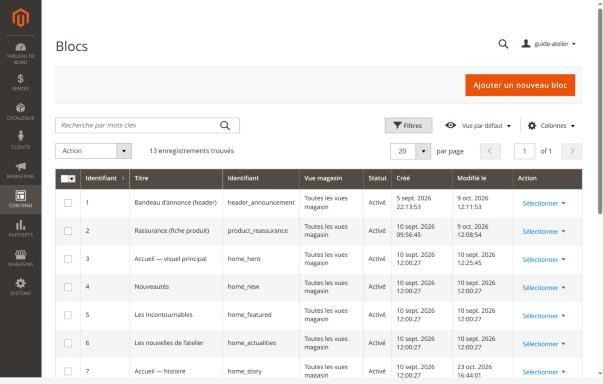

| Identifiant | Où il s'affiche |
|---|---|
| `header_announcement` | Le bandeau tout en haut du site |
| `home_hero`, `home_story`, `home_actualities` | L'accueil : visuel principal, histoire, nouvelles de l'atelier |
| `product_reassurance` | Les arguments sous le bouton d'achat des fiches |
| `cart_reassurance` | Les arguments du panier |
| `contact_help`, `contact_locations` | La page contact |

Ouvrez le bloc, modifiez le texte, **Enregistrer**. Le changement est visible en boutique aussitôt. Ne changez
pas l'**Identifiant** : le site ne retrouverait plus le bloc.

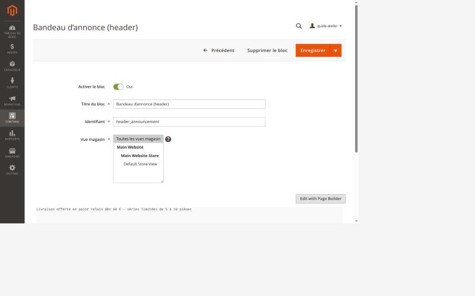

*Contenu › Pages* : « À propos », « Nos tissus », les pages juridiques (CGV, mentions légales, livraison et retours,
confidentialité).

## 6. Les réglages de la boutique

*Magasins › Configuration › Madame Aiguille* : réseaux sociaux, mentions légales, catalogue, panier, formulaire de
contact, Mondial Relay, retrait à l'atelier, emballage cadeau. Ouvrez un groupe, décochez **Utiliser les valeurs
système** pour modifier un champ, puis **Sauvegarder la configuration**.

- **Réseaux sociaux** : l'adresse de chaque réseau ; laissez vide pour masquer son icône dans le pied de page.

  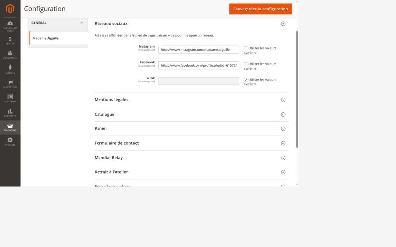

- **Retrait à l'atelier** : nom et adresse du lieu, plan d'accès, **disponibilités de chaque semaine**, durée d'un
  créneau, délai de prévenance, jours fermés.

  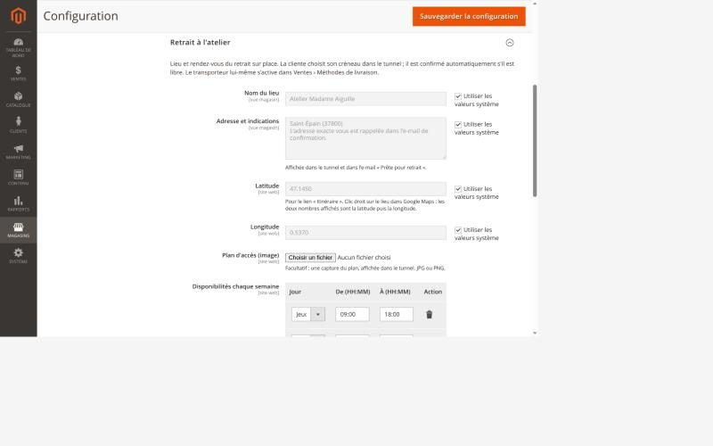

- **Emballage cadeau** : proposer ou non l'option, son prix et son texte.
- **Mondial Relay** : le code enseigne (ne pas toucher) et le poids de l'emballage (0,2 kg).

*Marketing* : **Règles de prix du panier** pour un code promo, **Gabarits d'email** pour relire les textes des emails,
**Abonnés à la newsletter**.

## 7. Consulter les statistiques

Les statistiques de visite du site (combien de visites, quelles pages, d'où viennent les visiteuses, ce qu'elles
cherchent) sont dans **Matomo**, un outil installé sur le serveur de la boutique. Elles sont anonymes : on ne sait pas
*qui* visite, seulement *combien* et *comment*.

1. Dans l'administration, *Rapports › Statistiques du site* : Matomo s'ouvre dans un nouvel onglet.

   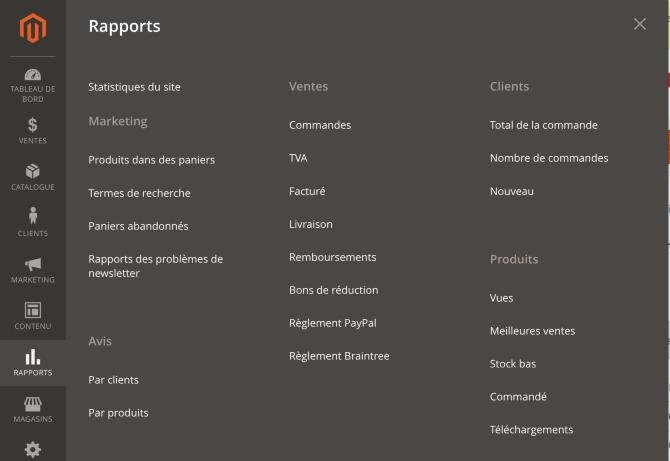

2. Connectez-vous avec **votre compte Matomo** (identifiant et mot de passe reçus par email à l'invitation de Pierre,
   distincts de ceux de Magento). Vous pouvez aussi ouvrir directement `https://stats.madame-aiguille.fr`.
3. Le **tableau de bord** résume la période choisie en haut (jour, semaine, mois…).

   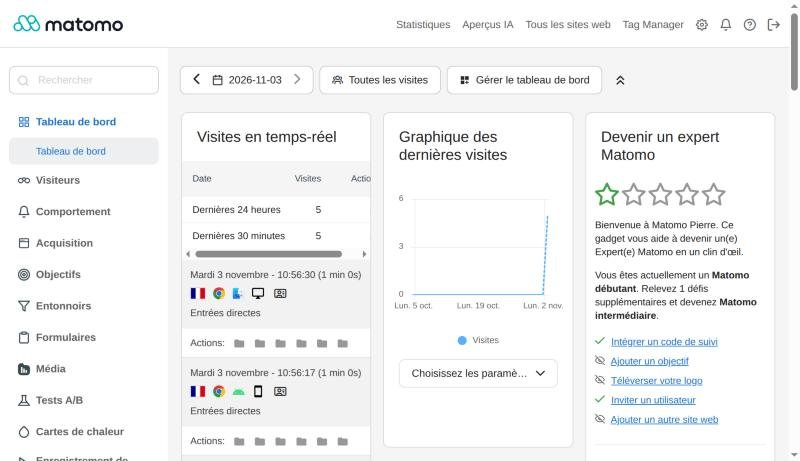

Les rapports les plus utiles, dans le menu de gauche :

| Je veux savoir… | Rapport |
|---|---|
| Combien de visites, et quand | *Visiteurs › Récapitulatif* |
| Qui est sur le site en ce moment | *Visiteurs › En temps réel* |
| Quelles pages sont les plus vues | *Comportement › Pages* |
| Par quelle page on arrive, par laquelle on part | *Comportement › Pages d'entrée* et *Pages de sortie* |
| D'où viennent les visites (Google, Instagram, lien direct…) | *Acquisition › Tous les canaux* et *Réseaux sociaux* |
| Téléphone ou ordinateur | *Visiteurs › Périphériques* |
| Pays et régions | *Visiteurs › Provenances géographiques* |
| Ce que les visiteuses cherchent dans la boutique | *Comportement › Recherche sur le site* : un mot souvent cherché sans résultat est une idée de création ou de mot-clé |
| Les liens cassés | *Comportement › Titres des pages*, ligne « 404 » : les pages introuvables et la page d'où venait le lien |

Le menu propose aussi des rubriques comme *Formulaires*, *Cartes de chaleur* ou *Enregistrement de session* : ce sont
des options payantes de Matomo, **non installées** (et qui demanderaient une bannière de consentement).

Chaque début de mois, un **rapport par email** arrive sur `contact@madame-aiguille.fr`.

Les visites de Pierre ne sont pas comptées ; les vôtres le seront tant que l'adresse internet de l'atelier n'est pas
transmise à Pierre, qui l'exclura. Les chiffres du jour se mettent à jour
toutes les heures ; seul le *Temps réel* est instantané. Votre compte est en **lecture seule** : vous ne pouvez rien
casser.

## 8. Rédiger une fiche avec l'assistant

L'assistant lit votre fiche et vos photos, vous pose quelques questions, puis vous propose les textes : la
description courte, la description longue, le titre et la description pour Google, l'adresse de la page (pour une
nouvelle création) et une phrase qui décrit chaque photo pour les personnes malvoyantes. **Il ne remplace pas votre
relecture** : rien n'est enregistré tant que vous n'avez pas cliqué sur **Enregistrer**.

### Avant de commencer

Remplissez d'abord ce que vous savez : nom, catégories, prix, poids, série limitée, **photos**, et si possible
composition, dimensions et entretien. Plus la fiche est complète, moins il y aura de questions et plus le texte sera
juste.

### 1. Analyser

Dans la section **Contenu**, au-dessus de la description, cliquez sur **Analyser la fiche**. Comptez 10 à
30 secondes.

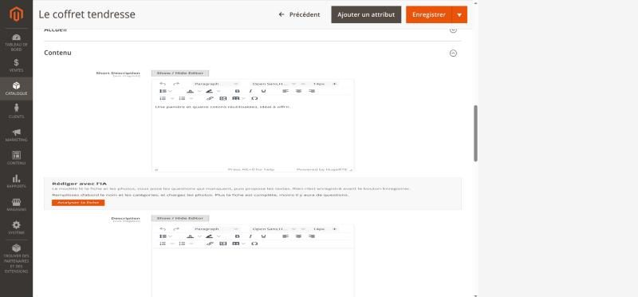

### 2. Répondre

L'assistant dit ce qu'il a compris, puis pose ses questions (huit au plus). Répondez simplement ; **laissez vide**
une question dont vous ne connaissez pas la réponse : il n'inventera rien à la place. Le champ **Notes libres** sert
à ajouter ce qu'il n'a pas demandé (l'histoire du tissu, une idée cadeau…). Cliquez sur **Rédiger les textes**.

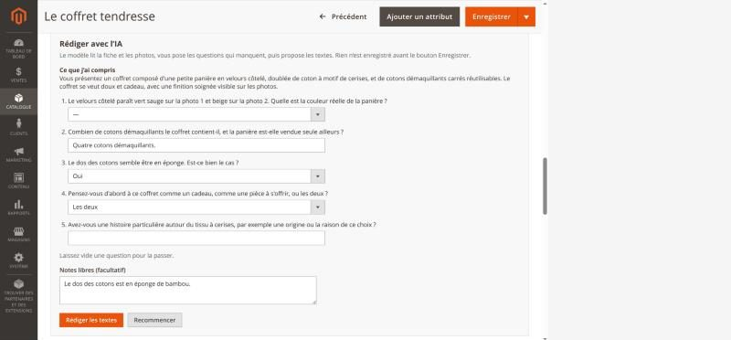

### 3. Relire l'aperçu

Chaque texte proposé a sa case. En haut, l'encadré jaune **« Points à confirmer »** liste ce que l'assistant n'a pas
pu vérifier : **réglez-les toujours avant d'enregistrer**, soit en corrigeant le texte après l'insertion, soit en
complétant vos réponses (*Recommencer*). Les compteurs (« 99 / 150 ») indiquent la longueur conseillée ; en rouge,
le texte est trop long pour Google.

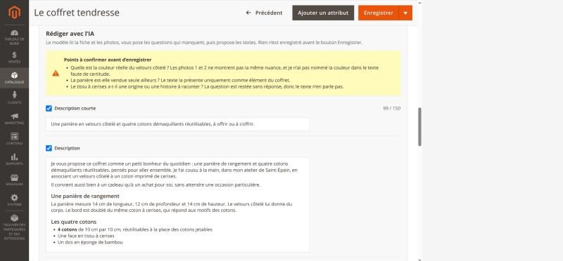

### 4. Retoucher, insérer, enregistrer

- **Plus court**, **Plus chaleureux**, **Régénérer**, ou votre propre consigne (« mentionner l'idée cadeau de
  Noël ») : l'assistant réécrit tout l'ensemble.
- Décochez ce que vous ne voulez pas, puis **Insérer dans la fiche** : les champs cochés sont remplis, rien d'autre
  n'est touché.
- **Relisez dans le formulaire**, corrigez à la main si besoin, puis **Enregistrer**. Pour vérifier le rendu, ouvrez
  la fiche en boutique.

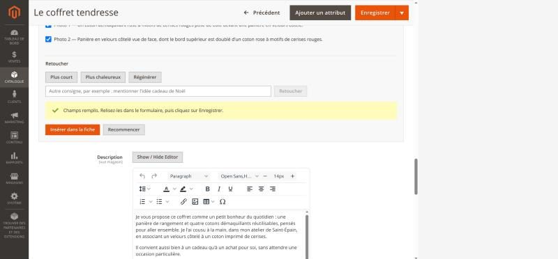

### Ce qu'il faut toujours relire

- **Les faits** : matières, dimensions, entretien, nombre de pièces, couleurs. L'assistant s'appuie sur vos réponses
  et vos photos, mais une photo peut tromper (une couleur, une matière).
- **Les formules sur votre travail** : il doit parler en votre nom (« je », « mon atelier ») et ne rien affirmer sur
  la fabrication que vous n'avez pas dit.
- **Les phrases qui se ressemblent d'une fiche à l'autre** : Google n'aime pas les textes répétés.
- Sur une création **déjà en ligne**, l'assistant ne propose pas de nouvelle adresse de page : la changer casserait
  les liens existants.

### Bon à savoir

- **50 demandes par jour** pour toute la boutique (analyses, rédactions et retouches). Au-delà, l'assistant reprend
  le lendemain.
- Un message rouge dans le panneau (service surchargé, crédit épuisé, clé refusée) ne touche **jamais** votre
  fiche. Réessayez quelques minutes plus tard ; si le message parle de crédit ou de clé, prévenez Pierre.
- Le bouton n'apparaît pas ? L'assistant est peut-être coupé, ou votre rôle n'y a pas accès : demandez à Pierre.

## 9. En cas de doute

- Une action irréversible (avoir, annulation) : prenez le temps de relire le montant et la commande.
- Un message d'erreur, une page qui ne s'ouvre pas, un réglage introuvable : notez l'heure et la page, et prévenez Pierre.
